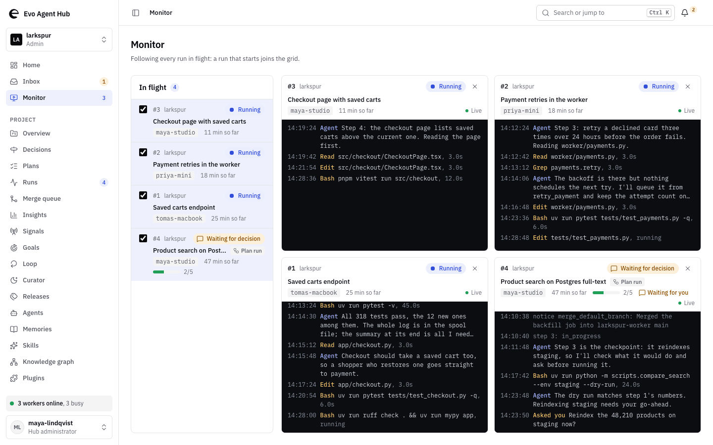

# evo-agents

Run coding agents across your repositories, on machines you control.

evo-agents gives your team a place to hand off work to **Claude Code, Codex CLI or opencode** and follow it through.
Agents work through a plan, run its checks and push their changes. You can watch the work in your browser, answer
questions when needed, or take over a run.

[Get started](docs/getting-started.md) | [Website](https://agents.omelet.tech) | [Documentation](#documentation)


*Demo hub with fictional projects, people and machines.*

## Less time coordinating agents

A change can span an API, a frontend and a shared library. Keeping the agents supplied with the right context,
tracking what passed, and picking up work on another machine can become a job of its own.

- **Hand off a whole plan.** Each step has dependencies and checks. A worker runs the checks again before recording
  completion, with commits and results attached to the run.
- **Keep project context between sessions.** Agents share plans, memories and a searchable knowledge graph of code
  and documents across your repos.
- **See what needs you.** Follow live runs in the Monitor. Answer decisions in the Inbox or through Telegram when
  configured. Your autonomy settings determine which actions need approval.
- **Use your own machines.** Run workers on a laptop, desktop or server, using your coding-agent accounts. You can
  host the hub yourself, too.

The **hub** holds the plans and shows progress. A **worker** runs the agent on a machine you connect.

## Give it a piece of work

On your project's Plans page, choose **New plan** and describe the change:

> Add saved carts to checkout. Cover the API and frontend, and include tests for restoring a cart after sign-in.

An agent on your worker drafts the plan. Review its scope and checks, then choose **Run plan**. Follow each step and
its output in the browser; you can send the agent a message or stop the run there.

## Quick start

**Run agents with a team.** You'll need access to a hub and a machine with a coding agent installed and signed in.
[Ask for an invite](https://github.com/maycuatroi1/evo-agents/issues/new?template=invite.yml), use your team's hub, or
[self-host](docs/hub-deployment.md). Install Python 3.11+ and [uv](https://docs.astral.sh/uv/), then run:

```sh
uv tool install 'evo-ak[graphify,worker]'
evo-agents hub login --url https://hub.example.org
```

Use your hub's URL in place of `https://hub.example.org`. Then follow the
[setup guide](docs/getting-started.md#run-your-first-plan) to connect a project and worker. Workers run on macOS and
Linux, or inside WSL on Windows.

**Try the knowledge graph on its own.** You can index a local repository and explore its code without a hub account
or a running agent. Follow the [local walkthrough](docs/getting-started.md#try-the-knowledge-graph-locally).

The package is named `evo-ak` on PyPI; the command is `evo-agents`. evo-agents is **pre-1.0**: commands and formats can
change between releases.
See the [roadmap](docs/roadmap.md) for current capabilities and unfinished work.

## Documentation

| I want to... | Read |
| --- | --- |
| Set up a project and run a plan | [Getting started](docs/getting-started.md) |
| Monitor runs and manage workers | [Operations](docs/operations.md) |
| Index repos and configure the graph | [Graph setup](docs/kg-setup.md), [query reference](docs/kg.md) |
| Set permissions and handle credentials | [Autonomy](docs/autonomy.md), [credentials](docs/credentials.md) |
| Host a hub or build a plugin | [Deployment](docs/hub-deployment.md), [plugins](docs/plugins.md) |
| Contribute code or documentation | [Contributing](CONTRIBUTING.md) |

Agent instructions and MCP details are in [AGENTS.md](AGENTS.md) and the [agent guide](docs/agents.md).

## License

[Apache-2.0](LICENSE).
