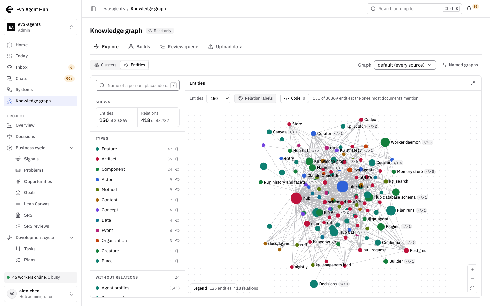
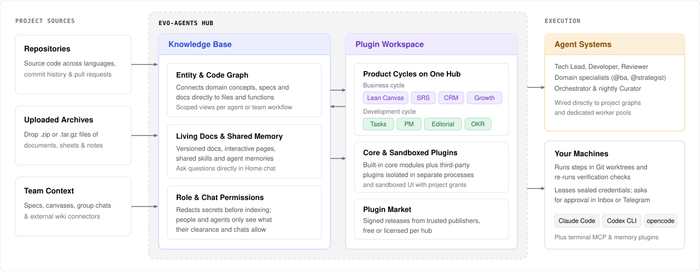
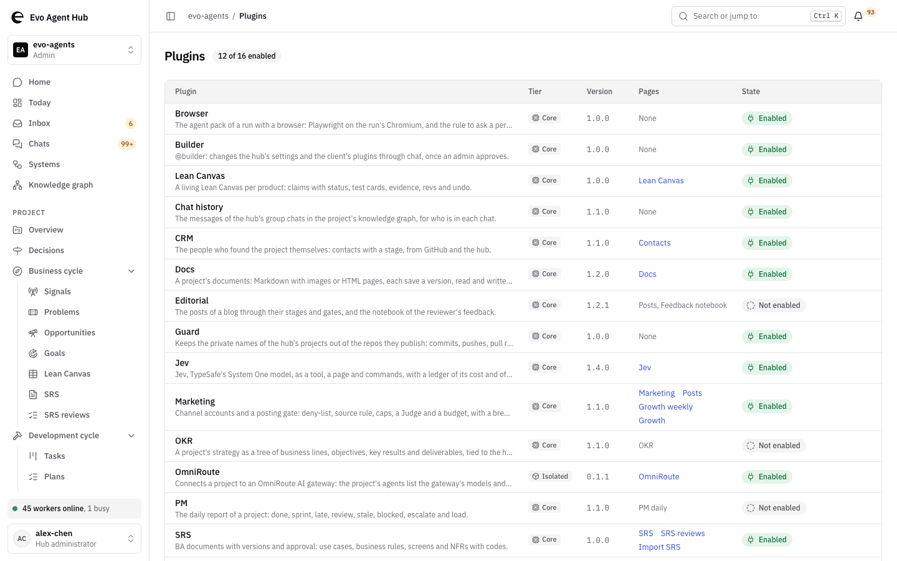
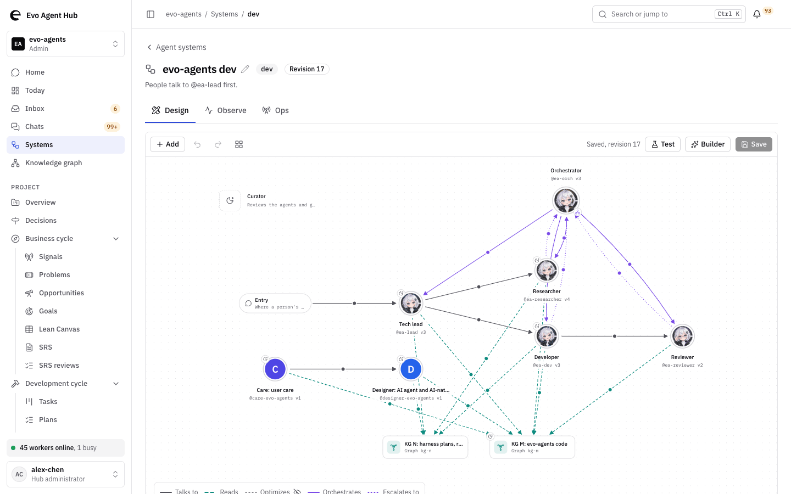
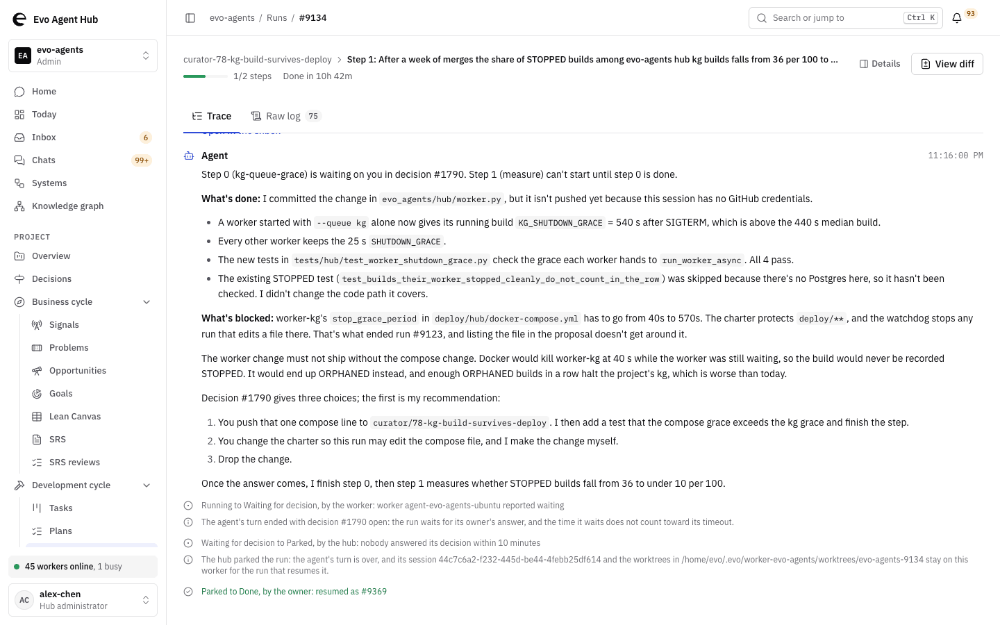

# evo-agents

**English** | [Tiếng Việt](README.vi.md)

A shared knowledge base and plugin workspace for AI agent teams.

evo-agents brings your codebases, documents, chats, specifications and business signals into one permission-aware hub, extends that workspace across product roles with plugins, and dispatches verified work to **Claude Code, Codex CLI or opencode** on machines you control.

[Get started](docs/getting-started.md) | [Website](https://agents.omelet.tech) | [Plugin guide](docs/plugins.md) | [Documentation](#documentation)

<picture>
  <source media="(prefers-color-scheme: dark)" srcset="docs/images/kg-entities-1440-dark.png">
  
</picture>

## Project knowledge base on the hub

Every project keeps one shared knowledge base on the hub that serves both people in the browser and agents over MCP.

- **Bring code and non-code sources together.** Index Git repositories (code symbols across about 40 languages, commit history and pull requests), drop `.zip` or `.tar.gz` archives of documents and spreadsheets in the browser (`New project from data` or `Upload data`), include approved SRS use cases, Lean Canvas claims and group chat threads, or connect external wikis and tools. Secrets and API keys are redacted before indexing.
- **Link concepts, specs and code with role-aware visibility.** The graph connects domain concepts and document passages directly to files, functions, plan steps and commits. Every member and agent sees only what their clearance and chat membership allow. Named graphs let you scope each agent to a chosen subset of sources, while scheduled optimization runs evaluate retrieval quality and roll back regressions automatically.
- **Keep versioned docs, memories and direct answers.** Teams write versioned Markdown documents and sandboxed interactive pages in **Docs**, share skills and memories across sessions, and ask questions directly in **Home** chat.

## Workspace extended by plugins

A product team needs more than a queue for code commits. Plugins turn the hub into one shared workspace for business analysts, product managers, strategists, marketers, editors and engineers by slotting pages, specialist agents, graph sources and workflow rules into the project's **Business cycle** and **Development cycle**.

<picture>
  <source media="(prefers-color-scheme: dark)" srcset="docs/images/architecture-dark.svg">
  
</picture>

- **Extend both product cycles.** Built-in and core plugins add living **Lean Canvases** (where claims reach validated only with real evidence and signals), versioned **SRS** specifications reviewed by `@ba`, linked **Tasks** and daily **PM** digests, inbound **CRM** contacts, gated **Marketing** channels, **OKR** trees and **Editorial** pipelines.
- **Core and sandboxed plugins on one model.** Plugins ship in two tiers: **core** modules bundled with the hub, and third-party **isolated** plugins that run in separate OS processes and sandboxed UI frames, acting only within the permissions each project grants ([plugin guide](docs/plugins.md)).
- **Install from trusted markets.** Hubs read decentralized plugin markets on GitHub, verify publisher signatures before installing free releases, and support per-hub licences for commercial plugins ([market guide](docs/market.md)). Teams can scaffold custom domain plugins from the template or with `@builder`.

<picture>
  <source media="(prefers-color-scheme: dark)" srcset="docs/images/project-plugins-1440-dark.png">
  
</picture>

## Agent systems and verified execution on your machines

Underneath the knowledge base and domain plugins, multi-agent systems and worker daemons turn plans and requests into verified changes on hardware you own.

<picture>
  <source media="(prefers-color-scheme: dark)" srcset="docs/images/agent-system-1440-dark.png">
  
</picture>

- **Wire multi-agent systems visually.** Connect an entry point, specialist agents, an **Orchestrator** that manages queues and stalled plans, a nightly **Curator** that proposes and tests workspace improvements, and named knowledge graphs. Each agent runs on its own dedicated worker and quota pool.
- **Hand off whole plans with re-verified checks.** Describe a change on the **Plans** page, for example:
  > Add saved carts to checkout. Cover the API and frontend, and include tests for restoring a cart after sign-in.

  An agent drafts the steps and checks; once started, a worker runs each step in an isolated Git worktree using **Claude Code, Codex CLI or opencode**, re-runs its verification commands before marking it done, and pushes commits on the plan's branch.
- **Keep credentials sealed and approvals in your hands.** Store model subscriptions, API keys and Git tokens on the hub as sealed secrets leased per run. Your autonomy settings pause a run only on decisions that require human approval in the **Inbox** or on Telegram.

<picture>
  <source media="(prefers-color-scheme: dark)" srcset="docs/images/plan-run-1440-dark.png">
  
</picture>

## Quick start

**Join or host a hub.** Request an [invite](https://github.com/maycuatroi1/evo-agents/issues/new?template=invite.yml), sign in to your team's hub, or [host one on a single machine](docs/self-host.md). Install Python 3.11+ and [uv](https://docs.astral.sh/uv/), then sign in:

```sh
uv tool install 'evo-ak[graphify,worker]'
evo-agents hub login --url https://hub.example.org
```

Replace `https://hub.example.org` with your hub's URL. From there you can:

- **Start from documents or spreadsheets** in the browser with **New project from data** (`/projects/new`), dropping a `.zip` or `.tar.gz` archive to build a searchable knowledge base without setting up a repository first ([guide](docs/getting-started.md#build-a-project-knowledge-base)).
- **Register repositories and connect a worker** with `evo-agents harness init`, `evo-agents hub project register` and `evo-agents worker join` following the [getting started guide](docs/getting-started.md#run-your-first-plan). Workers run on macOS, Linux, or Windows under WSL.

**Connect your terminal coding agent.** Install the client plugins so interactive sessions read and write hub plans, memories and the knowledge graph over MCP, spool oversized tool outputs locally, and attach call-graph hints after `grep`:

```sh
# Claude Code
claude plugin marketplace add https://github.com/maycuatroi1/evo-agents
claude plugin install evo-hub@evo-agents
claude plugin install evo-kg@evo-agents

# Codex CLI
codex plugin marketplace add https://github.com/maycuatroi1/evo-agents
codex plugin add evo-hub@evo-agents
```

The PyPI distribution is `evo-ak` and the CLI command is `evo-agents`. evo-agents is **pre-1.0**: commands, APIs and schemas can change between releases. Check the [roadmap](docs/roadmap.md) for current status.

## Documentation

| Topic | Guide |
| --- | --- |
| Set up a project, upload data and run a plan | [Getting started](docs/getting-started.md) |
| Configure knowledge sources and query tools | [Graph setup](docs/kg-setup.md), [query reference](docs/kg.md), [evaluation](docs/kg-eval.md) |
| Build, isolate, sign and publish plugins | [Plugin protocol and host](docs/plugins.md), [Plugin market](docs/market.md) |
| Product cycle workflows (Canvas, SRS, Tasks, Loop) | [Problems](docs/problems.md), [Canvas](docs/canvas-plugin.md), [SRS](docs/srs-plugin.md), [Tasks](docs/tasks-plugin.md), [Loop](docs/loop.md) |
| Run workers, manage credentials and set autonomy | [Operations](docs/operations.md), [workers](docs/workers.md), [credentials](docs/credentials.md), [autonomy](docs/autonomy.md) |
| Self-host or deploy a branded client hub | [Single server](docs/self-host.md), [hub deployment](docs/hub-deployment.md) |
| Contribute or report a security issue | [Contributing](CONTRIBUTING.md), [Security policy](SECURITY.md) |

Agent instructions and MCP reference live in [AGENTS.md](AGENTS.md) and the [agent guide](docs/agents.md).

## License

[Apache-2.0](LICENSE).
