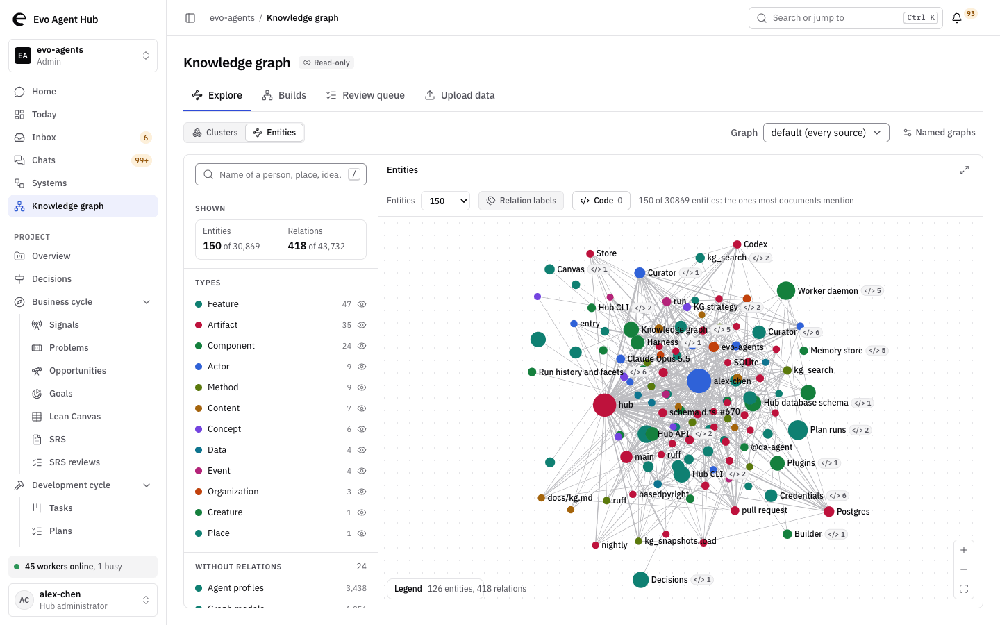
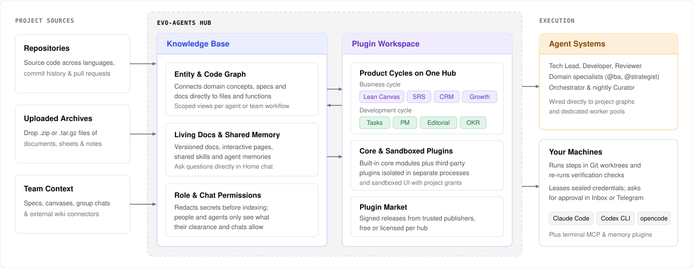
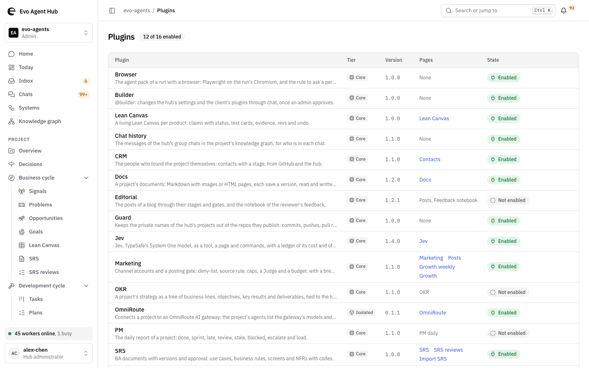
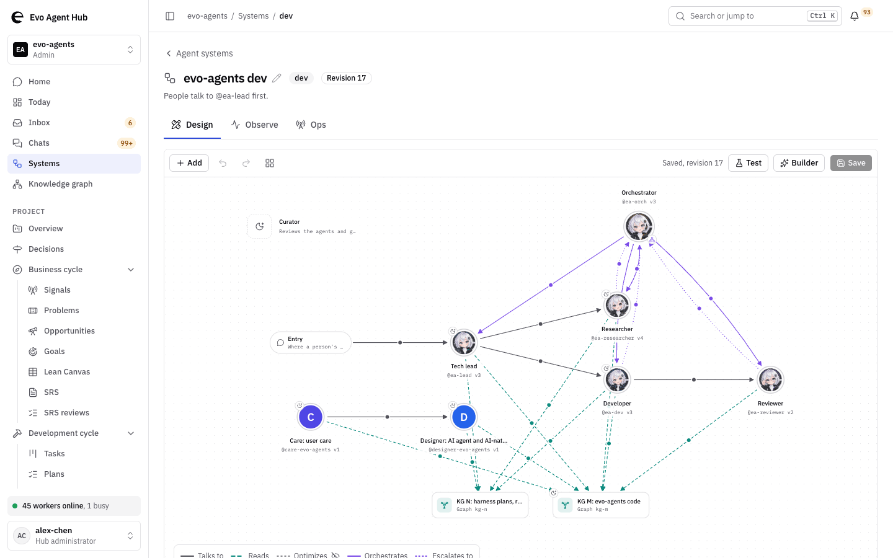
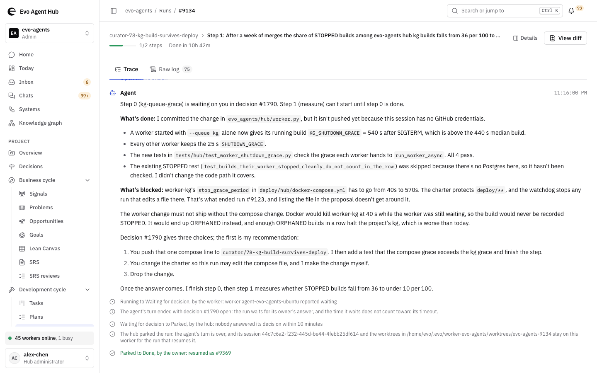

# evo-agents

[English](README.md) | **Tiếng Việt**

Knowledge base dùng chung và không gian làm việc mở rộng bằng plugin cho đội ngũ dùng AI agent.

evo-agents gom mã nguồn, tài liệu, tin nhắn nhóm, đặc tả sản phẩm và tín hiệu kinh doanh về một Hub có phân quyền chặt chẽ, mở rộng không gian làm việc cho từng vai trò qua hệ thống plugin, rồi giao việc có kiểm chứng cho **Claude Code, Codex CLI hoặc opencode** chạy trên dàn máy do bạn tự quản lý.

[Bắt đầu](docs/getting-started.md) | [Website](https://agents.omelet.tech) | [Tài liệu Plugin](docs/plugins.md) | [Tài liệu chi tiết](#tài-liệu)

<picture>
  <source media="(prefers-color-scheme: dark)" srcset="docs/images/kg-entities-1440-dark.png">
  
</picture>

## Knowledge Base tập trung trên Hub

Mỗi dự án duy trì một kho tri thức chung trên Hub, phục vụ đồng thời thành viên trên trình duyệt và các agent qua MCP.

- **Nạp chung cả mã nguồn lẫn tài liệu nghiệp vụ.** Lập chỉ mục các kho Git (symbol mã nguồn của khoảng 40 ngôn ngữ, lịch sử commit và pull request), kéo thả tệp nén `.zip` hoặc `.tar.gz` chứa tài liệu và bảng tính ngay trên trình duyệt (`New project from data` hoặc `Upload data`), đưa use case SRS đã duyệt, các ô trên Lean Canvas và hội thoại chat nhóm vào đồ thị, hoặc nối với wiki và công cụ ngoài. Khoá bí mật và API key đều được lược bỏ trước khi ghi vào kho.
- **Nối khái niệm, đặc tả với code kèm phân quyền theo vai trò.** Đồ thị liên kết trực tiếp các khái niệm miền nghiệp vụ và đoạn văn bản với tệp nguồn, hàm, bước thực thi trong plan và commit. Mỗi thành viên hay agent chỉ đọc được phần dữ liệu nằm trong mức quyền (`clearance`) và các phòng chat mà mình tham gia. Bạn có thể tạo các đồ thị con có tên riêng để giới hạn nguồn dữ liệu cho từng agent, kèm lịch tự đánh giá và tối ưu chất lượng truy xuất mỗi đêm.
- **Tài liệu lưu phiên bản, bộ nhớ chung và hỏi đáp trực tiếp.** Thành viên soạn tài liệu Markdown có lưu lịch sử phiên bản hoặc trang tương tác chạy trong khung cô lập tại mục **Docs**, đồng bộ kỹ năng (`skills`) và bộ nhớ (`memories`) xuyên suốt các phiên làm việc, đồng thời đặt câu hỏi trực tiếp ngay ở màn **Home** chat.

## Không gian làm việc mở rộng bằng Plugin

Một nhóm làm sản phẩm cần nhiều hơn một hàng đợi giao commit. Hệ thống plugin biến Hub thành mặt bằng làm việc chung cho BA, PM, người làm chiến lược, marketing, biên tập nội dung và kỹ sư bằng cách gắn thêm trang giao diện, agent chuyên trách, nguồn tri thức và luật tự động hoá vào hai chu trình **Business cycle** và **Development cycle** của dự án.

<picture>
  <source media="(prefers-color-scheme: dark)" srcset="docs/images/architecture-dark.svg">
  
</picture>

- **Bám sát cả hai chu trình sản phẩm.** Các plugin tích hợp sẵn và plugin core bổ sung **Lean Canvas** sống (mỗi giả thuyết chỉ sang trạng thái `validated` khi có bằng chứng và số đo thực), tài liệu đặc tả **SRS** quản lý phiên bản có `@ba` rà soát xung đột, bảng **Tasks** và báo cáo **PM** hằng ngày, danh sách khách hàng tự tìm đến trong **CRM**, kênh đăng bài có cổng kiểm duyệt của **Marketing**, cây mục tiêu **OKR** và quy trình biên tập **Editorial**.
- **Hai hạng plugin trên cùng một mô hình mở rộng.** Hệ thống gồm các module **core** đi kèm Hub và các plugin **isolated** của bên thứ ba chạy tách biệt ở tiến trình hệ điều hành riêng cùng khung giao diện cô lập (sandbox), chỉ hoạt động trong phạm vi quyền mà từng dự án cấp ([hướng dẫn plugin](docs/plugins.md)).
- **Cài đặt từ kho Plugin Market có chữ ký số.** Hub đọc danh mục plugin phân tán trên GitHub, xác thực chữ ký của nhà phát hành trước khi cài bản miễn phí và hỗ trợ cấp giấy phép theo từng Hub cho các plugin thương mại ([tài liệu market](docs/market.md)). Nhóm phát triển có thể tạo nhanh plugin cho ngành riêng từ mẫu có sẵn hoặc nhờ `@builder` dựng.

<picture>
  <source media="(prefers-color-scheme: dark)" srcset="docs/images/project-plugins-1440-dark.png">
  
</picture>

## Hệ thống multi-agent và thực thi có kiểm chứng trên máy của bạn

Phía dưới lớp tri thức và plugin nghiệp vụ, các hệ multi-agent cùng worker daemon biến kế hoạch và yêu cầu thành thay đổi đã qua kiểm tra trên chính máy móc của bạn.

<picture>
  <source media="(prefers-color-scheme: dark)" srcset="docs/images/agent-system-1440-dark.png">
  
</picture>

- **Thiết kế trực quan hệ thống nhiều agent.** Nối điểm đón yêu cầu (`Entry`), các agent chuyên môn, **Orchestrator** điều phối hàng đợi và gỡ các kế hoạch bị kẹt, **Curator** trực ca đêm đề xuất và đo kiểm cải tiến cho dự án, cùng các đồ thị tri thức chuyên biệt. Mỗi agent vận hành trên cụm worker và hạn mức riêng.
- **Giao trọn kế hoạch kèm bước kiểm tra độc lập.** Mô tả thay đổi ở trang **Plans**, chẳng hạn:
  > Thêm tính năng lưu giỏ hàng ở trang thanh toán. Sửa cả API và frontend, thêm test cho việc khôi phục giỏ hàng sau khi đăng nhập.

  Agent sẽ phác thảo các bước và lệnh kiểm tra; khi bắt đầu chạy, worker thực hiện từng bước trong Git worktree tách rời bằng **Claude Code, Codex CLI hoặc opencode**, tự chạy lại lệnh kiểm tra trước khi ghi nhận hoàn tất rồi mới đẩy commit lên nhánh của kế hoạch.
- **Niêm phong thông tin xác thực và giữ quyền phê duyệt.** Lưu tài khoản model, API key và Git token trên Hub dưới dạng bí mật niêm phong cấp tạm theo từng lượt chạy. Thiết lập mức tự chủ giúp phiên chạy chỉ dừng lại ở những quyết định cần người duyệt trong **Inbox** hoặc qua Telegram.

<picture>
  <source media="(prefers-color-scheme: dark)" srcset="docs/images/plan-run-1440-dark.png">
  
</picture>

## Bắt đầu nhanh

**Tham gia hoặc tự vận hành Hub.** Gửi yêu cầu [xin lời mời](https://github.com/maycuatroi1/evo-agents/issues/new?template=invite.yml), đăng nhập vào Hub của nhóm, hoặc [dựng Hub trên một máy chủ đơn](docs/self-host.md). Cài Python 3.11+ cùng [uv](https://docs.astral.sh/uv/), sau đó đăng nhập:

```sh
uv tool install 'evo-ak[graphify,worker]'
evo-agents hub login --url https://hub.example.org
```

Thay `https://hub.example.org` bằng địa chỉ Hub của bạn. Sau bước này, bạn có thể chọn một trong hai hướng:

- **Khởi tạo ngay từ bộ tài liệu hoặc bảng tính** trên trình duyệt tại mục **New project from data** (`/projects/new`): thả tệp `.zip` hoặc `.tar.gz` để dựng kho tri thức tra cứu được ngay cả khi chưa tạo kho Git ([hướng dẫn](docs/getting-started.md#build-a-project-knowledge-base)).
- **Đăng ký các kho Git và nối máy worker** bằng `evo-agents harness init`, `evo-agents hub project register` và `evo-agents worker join` theo [hướng dẫn bắt đầu](docs/getting-started.md#run-your-first-plan). Worker chạy trên macOS, Linux, hoặc Windows qua WSL.

**Nối coding agent dưới terminal.** Cài các plugin phía máy trạm để phiên làm việc tương tác đọc/ghi kế hoạch, bộ nhớ và đồ thị tri thức trên Hub qua MCP, tự cất kết quả tool quá dài ra tệp riêng trên máy và gắn gợi ý phụ thuộc hàm ngay sau lệnh `grep`:

```sh
# Claude Code
claude plugin marketplace add https://github.com/maycuatroi1/evo-agents
claude plugin install evo-hub@evo-agents
claude plugin install evo-kg@evo-agents

# Codex CLI
codex plugin marketplace add https://github.com/maycuatroi1/evo-agents
codex plugin add evo-hub@evo-agents
```

Tên gói trên PyPI là `evo-ak`, tên lệnh CLI là `evo-agents`. evo-agents hiện ở giai đoạn **trước 1.0**: lệnh, API và định dạng cấu hình vẫn có thể thay đổi giữa các bản phát hành. Xem [roadmap](docs/roadmap.md) để nắm hiện trạng các tính năng.

## Tài liệu

| Chủ đề | Hướng dẫn |
| --- | --- |
| Tạo dự án, tải dữ liệu lên và chạy kế hoạch đầu tiên | [Getting started](docs/getting-started.md) |
| Cấu hình nguồn tri thức và bộ công cụ truy vấn | [Graph setup](docs/kg-setup.md), [query reference](docs/kg.md), [evaluation](docs/kg-eval.md) |
| Viết, cô lập, ký số và phát hành plugin | [Plugin protocol and host](docs/plugins.md), [Plugin market](docs/market.md) |
| Quy trình chu trình sản phẩm (Canvas, SRS, Tasks, Loop) | [Problems](docs/problems.md), [Canvas](docs/canvas-plugin.md), [SRS](docs/srs-plugin.md), [Tasks](docs/tasks-plugin.md), [Loop](docs/loop.md) |
| Vận hành worker, quản lý thông tin xác thực và mức tự chủ | [Operations](docs/operations.md), [workers](docs/workers.md), [credentials](docs/credentials.md), [autonomy](docs/autonomy.md) |
| Tự vận hành trên một máy chủ hoặc triển khai Hub riêng | [Single server](docs/self-host.md), [hub deployment](docs/hub-deployment.md) |
| Đóng góp mã nguồn hoặc báo cáo lỗ hổng bảo mật | [Contributing](CONTRIBUTING.md), [Security policy](SECURITY.md) |

Hướng dẫn dành cho agent và chi tiết MCP nằm tại [AGENTS.md](AGENTS.md) cùng [agent guide](docs/agents.md).

## Giấy phép

[Apache-2.0](LICENSE).
